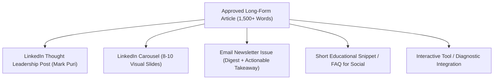

# 90-Day Content Roadmap & Social Repurposing Strategy: Puri & Loggia LLP

**Target Audience**: Canadian Business Owners, Founders, Tech Startups, Real Estate Investors, and Healthcare Practitioners ($500k to $15M revenue).  
**Goal**: Establish top-of-funnel organic search visibility, educate clients, generate high-intent consultation leads, and feed omnichannel social channels (LinkedIn, Newsletter).

---

## 1. Editorial Themes & Topic Clusters

The content strategy is anchored around four high-relevance topic pillars:
1. **Tax Optimization & CRA Navigation for Canadian Incorporations**
2. **Cloud Accounting Automation & Touchless Bookkeeping**
3. **Cash Flow Resilience, Working Capital & Fractional CFO Insights**
4. **Business Scaling, Mergers & Acquisition (M&A) and Exit Planning**

---

## 2. 90-Day Publication Calendar

| Week | Title & Primary Keyword | Target Persona | Intent & Funnel Stage | Core Lead Magnet |
|---|---|---|---|---|
| **W1** | *Salary vs. Dividends in Canada: The Definitive Tax Optimization Guide for Owner-Operators* (`salary vs dividends canada`) | Incorporated business owners | Consideration / High Intent | Canadian Owner-Operator Tax Planning Worksheet |
| **W2** | *CRA Audit Red Flags: 7 Critical Triggers Canadian Small Businesses Must Avoid* (`cra audit triggers`) | All small business owners | Top of Funnel / Problem Aware | CRA Audit Readiness Checklist (PDF) |
| **W3** | *Migrating from Desktop to Cloud: The Painless Blueprint for Xero & QBO Adoption* (`cloud accounting migration canada`) | Growing businesses on legacy desktop software | Solution Aware | Cloud Accounting Tech Stack Blueprint |
| **W4** | *How to Read Your Financial Statements Like a CFO: Income Statement, Balance Sheet & Cash Flow* (`how to read balance sheet`) | Early-stage founders & entrepreneurs | Educational / Trust Building | Financial Statement Health Scorecard |
| **W5** | *SR&ED Tax Credits in Ontario: Demystifying Eligible R&D Expenditures for Tech Startups* (`sred tax credit ontario`) | Tech founders, software dev firms | High Commercial Intent | SR&ED Pre-Screening Diagnostic |
| **W6** | *The 13-Week Cash Flow Forecast: The Ultimate Defense Against Inverted Working Capital* (`13 week cash flow forecast`) | Scaling businesses experiencing cash crunches | High Intent | Downloadable 13-Week Cash Flow Template |
| **W7** | *GST/HST Reporting Rules for Canadian E-Commerce: Shopify, Stripe & Cross-Border Sales* (`shopify gst hst canada`) | E-commerce merchants, digital creators | Problem Aware / High Search Volume | Canadian E-Commerce Tax Playbook |
| **W8** | *When Does a Canadian Business Need a Fractional CFO vs. an In-House Finance Hire?* (`fractional cfo ontario`) | $1M-$10M companies scaling rapidly | Decision / High Conversion | Fractional CFO Scoping Matrix |
| **W9** | *Holding Companies in Canada: Tax Deferral, Asset Protection & Capital Gains Exemption* (`holding company canada tax`) | Mature business owners, real estate investors | High Net Worth / Strategic | Corporate Reorganization Guide |
| **W10** | *Month-End Close in 5 Days: The Step-by-Step Blueprint for Frictionless Financial Reporting* (`month end close process`) | Operations managers & founders | Process Improvement | Month-End Closing SOP Checklist |
| **W11** | *Pricing Your Services for Profit: Moving from Cost-Plus to Value-Based Billing* (`business pricing strategy`) | Professional services, agency founders | Educational / Growth | Pricing & Gross Margin Calculator |
| **W12** | *Preparing Your Business for Sale: 5 Levers to Maximize Your Valuation Multiple* (`selling a business canada`) | Founders planning exits within 1-3 years | High Value Advisory | Exit-Readiness Assessment |

---

## 3. Social Repurposing Workflow (1 Article → 5 Assets)

For every approved blog post, the marketing team executes the following multi-channel repurposing sequence:

### Repurposing Execution Rules:
1. **LinkedIn Thought Leadership (Mark Puri profile)**: Focus on personal narrative, real-world case study lessons from 25+ years of entrepreneurial experience, and contrasting conventional accounting advice with high-impact strategic reality.
2. **LinkedIn Carousel**: Break down complex tax laws or 5-step frameworks into clear, visually scannable slides with high contrast and actionable takeaways.
3. **Monthly Client Newsletter**: Curate 2 actionable business insights, 1 CRA deadline reminder, and a featured tool/calculator with a direct consultation CTA.
